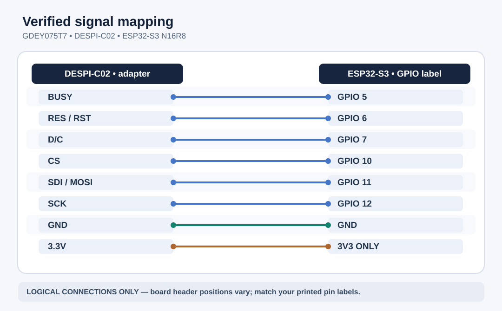

# E-Ink Project

**ESP32-S3 N16R8 · Good Display GDEY075T7 · DESPI-C02**  
**Status:** ✅ full refresh tested · ✅ partial refresh tested · 🟡 multi-region layout still being refined

> **Workflow:** VS Code = code, docs and Git · Arduino IDE 2 = verify, upload and Serial Monitor. **No PlatformIO.**



## Start here

**Working Arduino IDE configuration captured:** [full Tools screenshot + settings table](docs/arduino-ide.md). On Windows, install [Git for Windows](https://git-scm.com/install/windows) before running `git` commands; see the [step-by-step Git guide](docs/git.md).


| Goal | Read |
| --- | --- |
| **Replace the older local project safely** | [docs/migration.md](docs/migration.md) |
| **Correct wiring and hardware precautions** | [docs/hardware.md](docs/hardware.md) |
| **Verified Arduino IDE Tools menu (screenshot) and libraries** | [docs/arduino-ide.md](docs/arduino-ide.md) |
| **Tests and measured performance** | [docs/tests.md](docs/tests.md) |
| **Edit → Arduino flash → document → commit** | [docs/workflow.md](docs/workflow.md) |
| **Install Git for Windows, create repo and push to GitHub** | [docs/git.md](docs/git.md) |
| **Historical results / updates** | [docs/LOG.md](docs/LOG.md) |

### Firmware — open ONE `.ino` file in Arduino IDE

| Sketch | Purpose | Status |
| --- | --- | --- |
| [`00_board_info`](firmware/00_board_info/00_board_info.ino) | Serial, flash and PSRAM diagnostic | Utility |
| [`01_full_refresh_v6`](firmware/01_full_refresh_v6/01_full_refresh_v6.ino) | Two full-screen patterns; BUSY counts | ✅ Tested |
| [`02_partial_refresh_v7`](firmware/02_partial_refresh_v7/02_partial_refresh_v7.ino) | Counter updates only in one window | ✅ Tested |
| [`03_multi_region_v8`](firmware/03_multi_region_v8/03_multi_region_v8.ino) | Several changing dashboard regions | 🟡 Experimental |

Arduino IDE expects **the `.ino` basename to match its containing folder**. This repository follows that rule. Open the file in place; **do not use Save As** to make a disconnected copy elsewhere.

## Confirmed logical GPIO mapping

| DESPI-C02 | ESP32-S3 |
| --- | --- |
| BUSY | GPIO **5** |
| RES | GPIO **6** |
| D/C | GPIO **7** |
| CS | GPIO **10** |
| SDI / MOSI | GPIO **11** |
| SCK | GPIO **12** |
| 3.3V | **3V3** only |
| GND | **GND** |

⚠️ Physical header order depends on your particular ESP32-S3 board. **N16R8 is the memory variant, not a pinout**. Preserve the jumper positions that passed V6/V7. Use the printed labels on YOUR board, not a generic pinout image.

## Repository layout

```text
eink-project/
├─ README.md                     <- overview and navigation
├─ firmware/
│  ├─ 00_board_info/             <- standalone board/serial check
│  ├─ 01_full_refresh_v6/        <- PASSED reference test
│  ├─ 02_partial_refresh_v7/     <- PASSED reference test
│  └─ 03_multi_region_v8/       <- experimental display test
├─ docs/
│  ├─ images/wiring-map.svg      <- logical pin diagram, NOT header placement
│  ├─ hardware.md                <- connections and electrical safety
│  ├─ arduino-ide.md             <- IDE settings + libraries
│  ├─ tests.md                   <- what each sketch proves
│  ├─ LOG.md                     <- actual test history
│  ├─ migration.md               <- old ZIP -> cleaned project
│  ├─ workflow.md                <- daily editing routine
│  └─ git.md                     <- initialize + first push
├─ .vscode/                      <- recommended editor settings/extensions
├─ .gitignore                    <- excludes binaries and credentials
└─ .editorconfig                 <- consistent formatting
```

### Current hardware milestone

- V6: two full-screen images rendered; controller full refresh around **1,542 ms**.
- V7: partial center updates successful without visible ghosting; steady end-to-end partial refresh around **493 ms**.
- V8: displayed and updated, but layout/visuals require another iteration. It is not a validated dashboard.
- Actual ESP32 development **PCB manufacturer/revision** is still unknown. A photo of your working wiring belongs in `docs/images/` once identified.

**Next project phase (new chat):** build the actual dashboard. Before then, finish this cleanup and your first Git push. For a new chat, provide the repository README or ZIP; a chat cannot automatically see files stored only on your PC.

## Official references

- [GDEY075T7 panel](https://www.good-display.com/product/396.html)
- [DESPI-C02 adapter](https://www.good-display.com/product/516.html)
- [GxEPD2 library](https://github.com/ZinggJM/GxEPD2)
- [Espressif Arduino-ESP32 Tools menu](https://docs.espressif.com/projects/arduino-esp32/en/latest/guides/tools_menu.html)
