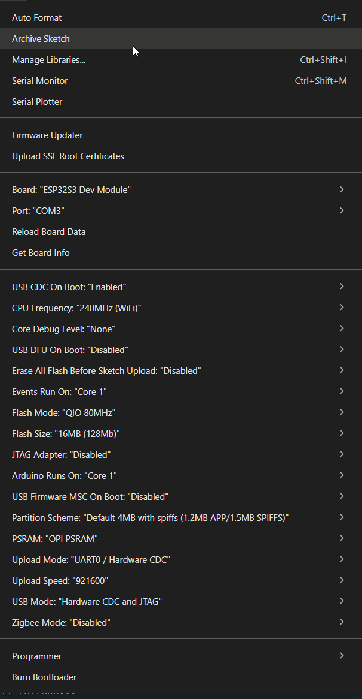

# 03 · Arduino IDE — verified working configuration

> **Known-good setup (29 October 2026).** ESP32-S3 N16R8 + Good Display GDEY075T7 + DESPI-C02. The values below are transcribed from the actual Arduino IDE **Tools** screenshot after successful V6 and V7 testing. **Keep these settings unchanged for baseline tests.**

**Workflow:** Edit `.ino` and Markdown in **VS Code** → open the same `.ino` in **Arduino IDE 2** to Verify, Upload and use Serial Monitor. No PlatformIO required.

## Working Tools menu — verified from screenshot

| Tools menu item | Selected value |
| --- | --- |
| **Board** | `ESP32S3 Dev Module` |
| **Port** | `COM3` (may change when reconnecting USB) |
| **USB CDC On Boot** | `Enabled` |
| **CPU Frequency** | `240MHz (WiFi)` |
| **Core Debug Level** | `None` |
| **USB DFU On Boot** | `Disabled` |
| **Erase All Flash Before Sketch Upload** | `Disabled` |
| **Events Run On** | `Core 1` |
| **Flash Mode** | `QIO 80MHz` |
| **Flash Size** | `16MB (128Mb)` |
| **JTAG Adapter** | `Disabled` |
| **Arduino Runs On** | `Core 1` |
| **USB Firmware MSC On Boot** | `Disabled` |
| **Partition Scheme** | `Default 4MB with spiffs (1.2MB APP/1.5MB SPIFFS)` |
| **PSRAM** | `OPI PSRAM` |
| **Upload Mode** | `UART0 / Hardware CDC` |
| **Upload Speed** | `921600` |
| **USB Mode** | `Hardware CDC and JTAG` |
| **Zigbee Mode** | `Disabled` |

### Software and monitor

| Item | Value / status |
| --- | --- |
| **ESP32 boards package** | `esp32 by Espressif Systems`, version **3.3.12** in the successful upload log (verify current installation if upgraded later) |
| **Arduino IDE** | Version **not yet recorded**; check Help → About |
| **Serial Monitor baud** | **115200** (all reference sketches) |
| **GxEPD2** | Library installed and proven to work; **exact installed version not yet recorded** |
| **Adafruit GFX Library** | Used with GxEPD2; **exact installed version not yet recorded** |
| **ESP32 hardware pin map** | BUSY 5, RES 6, D/C 7, CS 10, MOSI 11, SCK 12; see [hardware.md](hardware.md) |

> **Partition note:** This is a **16 MB flash device** running a **Default 4MB** partition layout. This is valid for the current small test programs and explains the earlier ~1.25 MiB maximum sketch size. Do not change the working partition layout solely to use all flash. Review it deliberately when adding large dashboard assets, file storage, or OTA updates.

## Repeatable upload checklist

1. Leave working jumper wires in place. Connect ESP32 to the same USB port used for the working tests.
2. In Arduino IDE: **File → Open** → select, for example, `firmware/01_full_refresh_v6/01_full_refresh_v6.ino` in this project.
3. Verify **Tools → Board → ESP32S3 Dev Module** and the currently available **Tools → Port** (previously COM3).
4. Keep all Tools settings as listed above.
5. Click **Verify**, then **Upload**. Open Serial Monitor at **115200 baud**.
6. Clear old Serial Monitor lines, press **EN/RESET** if necessary, and look for the **new sketch's unique heading**.
7. Record result in [LOG.md](LOG.md). Edit and save `.ino` in VS Code, then recompile/upload from Arduino IDE.

## If setting up a new computer

1. Install [Arduino IDE](https://www.arduino.cc/en/software).
2. **File → Preferences → Additional Boards Manager URLs:**
   `https://espressif.github.io/arduino-esp32/package_esp32_index.json`
3. **Tools → Board → Boards Manager** → install Espressif's **esp32** platform; use the recorded core version if aiming to reproduce this known-good environment.
4. **Sketch → Include Library → Manage Libraries** → install **GxEPD2** (Jean-Marc Zingg) and **Adafruit GFX Library**.
5. Set board/Tools options to the values above; reconnect and select the current COM port.

## VS Code notes

- Open the **project root folder**, not a single sketch. The `.vscode/` settings and relative Markdown links then work.
- `Ctrl+Shift+V` previews Markdown. Save `.ino` in VS Code (`Ctrl+S`) before Arduino IDE uploads it.
- If the same `.ino` is open in both editors, reload externally changed content and avoid conflicting unsaved copies.
- Ignore IntelliSense errors until confirmed by **Arduino IDE Verify**: VS Code may not resolve Arduino-specific headers without an Arduino language server.

## Quick troubleshooting

| Symptom | Check |
| --- | --- |
| No new Serial Monitor lines | Current COM port; 115200 baud; USB CDC enabled; hit RESET; clear stale text |
| Upload succeeded but old firmware appears | Verify which `.ino` Arduino IDE is open; re-upload; watch new heading after RESET |
| Port changed | Re-select it under Tools → Port |
| `GxEPD2_BW.h` missing | Install GxEPD2 from Library Manager |
| Display stays blank | Restore the **working physical wiring** and run V6 before changing firmware; see [hardware.md](hardware.md) |

Official references: [Espressif Arduino Tools menu](https://docs.espressif.com/projects/arduino-esp32/en/latest/guides/tools_menu.html) · [USB CDC setup](https://docs.espressif.com/projects/arduino-esp32/en/latest/tutorials/cdc_dfu_flash.html) · [GxEPD2](https://github.com/ZinggJM/GxEPD2).
